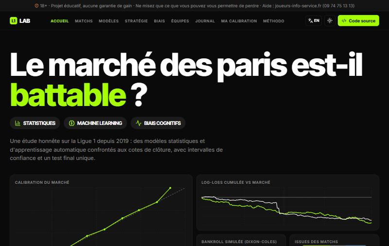
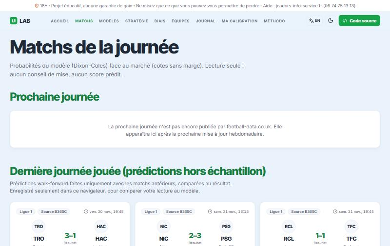

# Ligue 1 Lab : le marché des paris sportifs est-il battable ?

> Projet éducatif de data science. **Aucune garantie de gain, aucune mise réelle** : simulation
> et paper trading uniquement. 18+ · Ne misez que ce que vous pouvez perdre · joueurs-info-service.fr




## La question

Une fois la marge retirée, les cotes de clôture de la Ligue 1 sont-elles des probabilités qu'un
modèle construit sur des données publiques peut battre ? Le projet met cette question à l'épreuve
avec un protocole sans fuite de données, des intervalles de confiance partout et **un seul test
final**. Une réponse négative bien démontrée est un résultat valable.

## Réponse courte : non

Test final : 711 matchs (16/08/2024 → 22/11/2026), jamais utilisés pour faire un choix.

| Modèle | Log-loss [IC95] | Écart au marché [IC95] |
|---|---|---|
| **Marché** (clôture sans marge) | **0,966** [0,932 ; 1,000] | – |
| Combinaison (apprise sur validation) | 0,967 | +0,001 [−0,000 ; +0,002] |
| Elo | 0,990 | +0,024 [+0,009 ; +0,039] |
| Logistique multinomiale | 1,000 | +0,034 [+0,016 ; +0,052] |
| Dixon-Coles | 1,001 | +0,035 [+0,013 ; +0,062] |
| LightGBM | 1,004 | +0,038 [+0,017 ; +0,057] |
| Fréquences | 1,063 | +0,097 [+0,068 ; +0,125] |

- **Aucun modèle ne bat le marché** ; la combinaison met 96 % de son poids sur le marché. Test
  d'encompassing : le LightGBM n'apporte aucune information au-delà du marché (p = 0,99).
- **Stratégie simulée** (Kelly 1/4, cotes Bet365) : Closing Line Value de −4,8 % à −5,8 %, IC95
  entièrement négatif, soit le niveau d'un pari au hasard. Le ROI reste négatif même sans marge.
- **Biais cognitifs** (favori-outsider, séries, popularité PSG / OM, domicile, matchs médiatisés) :
  aucun effet significatif après correction de Holm, aucun exploitable après marge.

Détails, formules et discussion : [`docs/methodology.md`](docs/methodology.md).

## Données

[football-data.co.uk](https://www.football-data.co.uk), Ligue 1 2019-20 → 2026-27 (2 436 matchs) :
scores, tirs, cotes d'ouverture et de clôture. Pinnacle n'est plus publié depuis le 16/01/2026 :
la baseline passe alors à la clôture Bet365 (résultats aussi donnés sur Pinnacle seul). Pas de xG
historiques (Understat indisponible, FBref n'en affiche plus) : les tirs les remplacent.
Provenance et dates : [`data/README.md`](data/README.md).

## Méthodes

- **Modèles** : Elo séquentiel, Dixon-Coles avec décroissance temporelle (walk-forward),
  régression logistique multinomiale, LightGBM, calibration Platt / isotonique, pool log-linéaire.
- **Features** : 130 variables strictement point-in-time (`build_features`).
- **Protocole** : rodage 2019-20, apprentissage 2020-21 → 2022-23, validation 2023-24 +
  validation croisée temporelle, test unique 2024-25 → aujourd'hui.
- **Évaluation** : log-loss, Brier, calibration, IC95 bootstrap, écart apparié au marché,
  correction de Holm, test d'encompassing, SHAP, Closing Line Value, Monte Carlo de bankroll.
- **Tests anti-fuite** : modifier un résultat futur ne change aucune feature ni prédiction
  passée (Elo, Dixon-Coles, pipeline, features), vérifié aussi sur les vraies données.

## Reproduire (3 commandes)

```powershell
python -m venv .venv; .venv\Scripts\pip install -e ".[lab,dev]"
.venv\Scripts\python tasks.py all
.venv\Scripts\python tasks.py web
```

`tasks.py` remplace `make` sous Windows (le `Makefile` y délègue) :

| Commande | Effet |
|---|---|
| `python tasks.py data` | télécharge les CSV et affiche le rapport de cohérence |
| `python tasks.py train` | modèles ML (test final), stratégie, biais |
| `python tasks.py artifacts` | écrit `web/public/data/*.json` |
| `python tasks.py web` | construit le site statique (`web/out`) |
| `python tasks.py test` / `lint` | pytest (62 tests) / ruff |
| `python tasks.py predict` | prédictions de la prochaine journée, journal de paper trading |
| `python tasks.py app` | outil de labo Streamlit (interne) |

## Structure

```
src/ligue1lab/   core (données, marché, métriques), models (Elo, Dixon-Coles), features,
                 ml, strategy, biases, xg, predict, backtest, synth
tests/           62 tests, dont les tests anti-fuite
web/             site Next.js (export statique) qui lit web/public/data/*.json
data/            README (provenance), team_names.csv, paper_trading/ (journal versionné)
docs/            methodology.md, PLAN.md, DECISIONS.md, JOURNAL.md
```

## Limites

Échantillon de test limité (un avantage de 0,005 de log-loss serait indétectable),
non-stationnarité du championnat, Bet365 comme proxy des bookmakers français, absence de xG et de
compositions d'équipe.

## Licence

MIT. Aucun logo de club ni photo : les équipes sont représentées par un code à 3 lettres.
